# Mantenimiento IPF

App para que alumnos y docentes del Instituto reporten desperfectos del edificio (una luz quemada, una canilla que pierde, un proyector roto) y reciban un aviso cuando se resuelven.

Trabajo Práctico N° 3: Permisos móviles (Taller Complementario - React Native II).
**Alumno:** Giuricich, Facundo

Hecha con Expo SDK 57, Expo Router y TypeScript. Usa cámara, ubicación, notificaciones y micrófono (solo para la nota de voz). Para las fotos usa el selector del sistema, sin pedir permiso de galería.

> Las respuestas de las Partes A a F están en [RESPUESTAS.md](./RESPUESTAS.md).

---

## Cómo correrla

```bash
npm install
npx expo start
```

Después se escanea el QR con **Expo Go**.

Para probar los textos de propósito y `blockedPermissions` hace falta una **development build** (en Expo Go no se ven, porque Expo Go es otra app con su propio manifiesto):

```bash
npx expo install expo-dev-client
npx expo run:android        # o: eas build --profile development --platform android
```

Para ver los archivos nativos que se generan:

```bash
npx expo prebuild --clean
```

---

## Árbol de carpetas de `src/app`

```
src/app
├── _layout.tsx                 # Stack principal (envuelve todo con AppProvider)
├── (tabs)
│   ├── _layout.tsx             # Tabs: Reportes, Avisos, Permisos
│   ├── index.tsx               # /            -> lista de reportes + "Nuevo reporte"
│   ├── avisos.tsx              # /avisos      -> bandeja de avisos
│   └── permisos.tsx            # /permisos    -> panel con el estado de cada permiso
├── reporte
│   ├── nuevo.tsx               # /reporte/nuevo      -> formulario
│   ├── escanear.tsx            # /reporte/escanear   -> lector de QR (4 estados)
│   ├── foto.tsx                # /reporte/foto       -> sacar foto o elegir de la galería
│   ├── ubicacion.tsx           # /reporte/ubicacion  -> ubicación actual o sector a mano
│   └── [id].tsx                # /reporte/[id]       -> detalle + "Simular resolución"
├── permisos
│   └── [recurso].tsx           # /permisos/[recurso] -> pantalla previa (modal)
└── ajustes-app.tsx             # /ajustes-app        -> interruptor de notificaciones
```

`(tabs)` es un grupo: no aparece en la URL, por eso `(tabs)/index.tsx` es `/` y `(tabs)/permisos.tsx` es `/permisos`. La pantalla previa está afuera del grupo de tabs para que se abra como modal (`presentation: "modal"` en `src/app/_layout.tsx`).

El resto del código:

```
src
├── components   # Boton, Cargando, PantallaPrevia, NotaDeVoz
├── hooks        # usePermiso, useRevisarAlVolver
└── lib          # permisos.ts, notificaciones.ts, ubicacion.ts, store.tsx, tipos.ts
```

---

## Bloque `plugins` de app.json (comentado)

El JSON no admite comentarios, así que acá va la versión explicada:

```jsonc
"plugins": [
  "expo-router",
  ["expo-splash-screen", { ... }],

  // va ANTES de expo-camera: si va después, el "microphonePermission: false"
  // de expo-camera le borra el texto del micrófono en iOS
  ["expo-audio", {
    // texto de propósito del micrófono (NSMicrophoneUsageDescription), solo para la nota de voz
    "microphonePermission": "Usamos tu micrófono para grabar una nota de voz que explique el desperfecto que reportás.",
    // RECORD_AUDIO en Android, también solo para la nota de voz
    "recordAudioAndroid": true,
    // no grabamos ni reproducimos con la app cerrada
    "enableBackgroundRecording": false,
    "enableBackgroundPlayback": false
  }],

  ["expo-camera", {
    // texto de propósito de la cámara en iOS (NSCameraUsageDescription)
    "cameraPermission": "Usamos tu cámara para leer el QR de la puerta del aula y sacar una foto del desperfecto que reportás.",
    // la app no graba video: sin micrófono en iOS...
    "microphonePermission": false,
    // ...y sin RECORD_AUDIO en Android
    "recordAudioAndroid": false
  }],

  ["expo-location", {
    // solo primer plano (NSLocationWhenInUseUsageDescription)
    "locationWhenInUsePermission": "Usamos tu ubicación para marcar en qué parte del instituto está el desperfecto que reportás.",
    // false = no se agregan las claves de "Siempre" ni la de movimiento
    "locationAlwaysAndWhenInUsePermission": false,
    "locationAlwaysPermission": false,
    "motionUsagePermission": false,
    // sin ubicación en segundo plano en ninguna plataforma
    "isAndroidBackgroundLocationEnabled": false,
    "isIosBackgroundLocationEnabled": false
  }],

  ["expo-image-picker", {
    // false = no se agrega NSPhotoLibraryUsageDescription: usamos el selector del sistema
    "photosPermission": false,
    // mismo texto que expo-camera (los dos escriben la misma clave)
    "cameraPermission": "Usamos tu cámara para leer el QR de la puerta del aula y sacar una foto del desperfecto que reportás.",
    // mismo texto que expo-audio. Si pongo false, este plugin BLOQUEA RECORD_AUDIO
    // y la nota de voz no anda en Android
    "microphonePermission": "Usamos tu micrófono para grabar una nota de voz que explique el desperfecto que reportás."
  }],

  // notificaciones locales. En iOS no llevan texto de propósito
  "expo-notifications"
]
```

### `blockedPermissions` (Android)

| Permiso bloqueado | Por qué |
|---|---|
| `SYSTEM_ALERT_WINDOW` | Mostrar sobre otras apps: no lo usamos. Lo trae la plantilla de Expo. |
| `READ_EXTERNAL_STORAGE` | Las fotos se eligen con el selector del sistema, no hace falta leer el almacenamiento. Lo agregan la plantilla, expo-image-picker y expo-file-system. |
| `WRITE_EXTERNAL_STORAGE` | No guardamos archivos fuera de la app. Mismo origen que el anterior. |
| `READ_MEDIA_IMAGES` | No pedimos acceso a la galería (requisito del TP y política de Google Play). Hoy ninguna librería lo agrega, pero lo bloqueo por las dudas. |
| `READ_MEDIA_VIDEO` | Mismo motivo que el anterior. |
| `ACCESS_BACKGROUND_LOCATION` | Solo usamos ubicación en primer plano. Lo bloqueo para que no se cuele aunque se cambie la config de expo-location. |

**¿Y `RECORD_AUDIO`?** Al principio lo tenía bloqueado, porque la app no grababa nada. Cuando agregué la nota de voz (desafío opcional) lo tuve que sacar de la lista, porque ahora sí se usa. Igual expo-camera sigue con `microphonePermission: false` y `recordAudioAndroid: false`: la cámara no graba sonido. El micrófono se pide **solo** cuando la persona toca "Grabar nota de voz".

---

## Tabla de permisos

| Recurso | Módulo | Cuándo se pide | Alternativa si se deniega |
|---|---|---|---|
| Cámara (escanear QR) | expo-camera | Al tocar "Escanear QR del aula" en el formulario | Escribir el código del aula a mano |
| Cámara (sacar foto) | expo-image-picker (`launchCameraAsync`) | Al tocar "Sacar foto" | Elegir la foto de la galería con el selector |
| Fotos | expo-image-picker (`launchImageLibraryAsync`) | Nunca: el selector del sistema no necesita permiso | No hace falta |
| Ubicación (primer plano) | expo-location | Al tocar "Usar mi ubicación actual" | Elegir el sector a mano (patio, pasillo, etc.) |
| Notificaciones | expo-notifications | Al activar el interruptor "Avisarme cuando se resuelva mi reporte" en `/ajustes-app` | Los avisos quedan en la pestaña Avisos |
| Micrófono (nota de voz) | expo-audio (`requestRecordingPermissionsAsync`) | Al tocar "Grabar nota de voz" en el formulario | Escribir la descripción con texto |

Antes de cada diálogo del sistema se muestra la pantalla previa `/permisos/[recurso]` con un solo botón "Continuar". Si el permiso está bloqueado, explica el camino en Ajustes (distinto para Android y para iOS) y el botón pasa a ser "Abrir Ajustes".

---

## Cómo funciona lo de permisos

- **`src/hooks/usePermiso.ts`**: `usePermiso(recurso)` devuelve `estado` (`'cargando' | 'concedido' | 'preguntable' | 'bloqueado'`), `parcial` (ubicación aproximada), `pedir()` y `abrirAjustes()`.
  - Se actualiza cada vez que la pantalla toma foco y cuando la app vuelve de Ajustes (con `useRevisarAlVolver`, que escucha `AppState`).
- **Lo que decide el estado** está en `calcularEstado()` de `src/lib/permisos.ts`:
  - `granted` → concedido;
  - si no, `canAskAgain` → preguntable;
  - si no → bloqueado.
- **No insistir:** la pantalla previa nunca aparece sola. Solo cuando la persona toca la función.
- **Notificaciones:** en Android se crea el canal `"reportes"` antes de pedir el permiso. En iOS se piden con `allowProvisional: true`, y si quedan provisionales el panel lo muestra como "provisional (iOS)". "Simular resolución" programa una notificación local a los 10 segundos. Si las notificaciones no están permitidas (o el interruptor está apagado), el aviso va a la bandeja `/avisos`.
- **Datos:** los reportes se guardan en memoria con un Context (`src/lib/store.tsx`), así que al cerrar la app se pierden. Para el TP alcanza, porque no hay backend.

---

## Auditoría del manifiesto (desafío opcional)

Corrí `npx expo prebuild --clean` y revisé el `AndroidManifest.xml` generado y los manifiestos de cada librería:

| Permiso | Quién lo agrega | ¿Queda? |
|---|---|---|
| `INTERNET` | Plantilla de Expo, expo-image, expo-file-system | Sí (de instalación) |
| `ACCESS_NETWORK_STATE` | expo-image | Sí (de instalación) |
| `VIBRATE` | Plantilla de Expo | Sí (de instalación, lo usan las notificaciones) |
| `CAMERA` | expo-camera, expo-image-picker | Sí |
| `ACCESS_COARSE_LOCATION` | expo-location | Sí |
| `ACCESS_FINE_LOCATION` | expo-location | Sí |
| `POST_NOTIFICATIONS` | expo-notifications | Sí |
| `RECEIVE_BOOT_COMPLETED` | expo-notifications | Sí (para reprogramar notificaciones si se reinicia el celular) |
| `RECORD_AUDIO` | expo-audio, expo-image-picker (expo-camera no, porque tiene `recordAudioAndroid: false`) | Sí, solo para la nota de voz |
| `MODIFY_AUDIO_SETTINGS` | expo-audio | Sí (de instalación, lo usa para grabar y reproducir) |
| `SYSTEM_ALERT_WINDOW` | Plantilla de Expo | **No**, quitado |
| `READ_EXTERNAL_STORAGE` | Plantilla, expo-image-picker, expo-file-system | **No**, quitado |
| `WRITE_EXTERNAL_STORAGE` | Plantilla, expo-image-picker, expo-file-system | **No**, quitado |

En iOS el `Info.plist` generado queda solo con `NSCameraUsageDescription`, `NSLocationWhenInUseUsageDescription` y `NSMicrophoneUsageDescription` (este último por la nota de voz). No quedan las claves de fotos ni de ubicación "siempre".

---

## Desafíos opcionales

- [x] **Auditoría del manifiesto:** la tabla de arriba.
- [x] **Notificaciones provisionales:** en iOS se piden con `allowProvisional: true` (`src/lib/notificaciones.ts`) y `/permisos` muestra "provisional (iOS)" cuando corresponde.
- [x] **Nota de voz:** `src/components/NotaDeVoz.tsx` graba con expo-audio. El micrófono se pide recién al tocar "Grabar nota de voz", pasando antes por la pantalla previa. En el detalle del reporte se puede escuchar.
- [x] **Bloqueo por plataforma:** la pantalla de permiso bloqueado muestra el camino exacto en Ajustes según `Platform.OS` (`TEXTOS` en `src/lib/permisos.ts`).

---

## Dónde la probé

La probé con Expo Go en mi iPhone (iOS 26.6.2). No llegué a hacer la development build, así que los diálogos muestran los textos de Expo Go y no los míos.

En Expo Go los permisos son de Expo Go, por eso en Ajustes aparece "Expo Go" y no "Mantenimiento IPF". El camino que muestra la app cuando un permiso está bloqueado es el de la app instalada.

---

## Capturas

En iPhone el diálogo del sistema aparece una sola vez: si decís que no, el permiso queda bloqueado y la app muestra cómo activarlo en Ajustes.

### Permisos bloqueados

| | | |
|---|---|---|
| 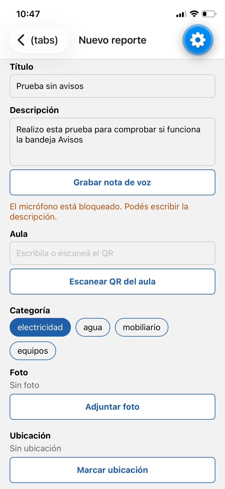 | 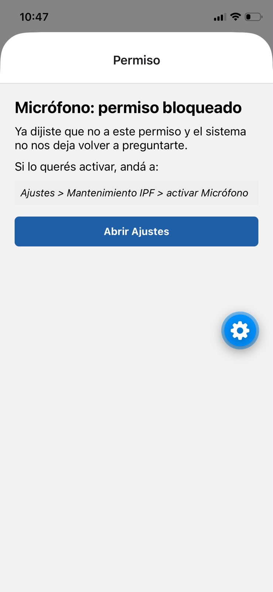 | 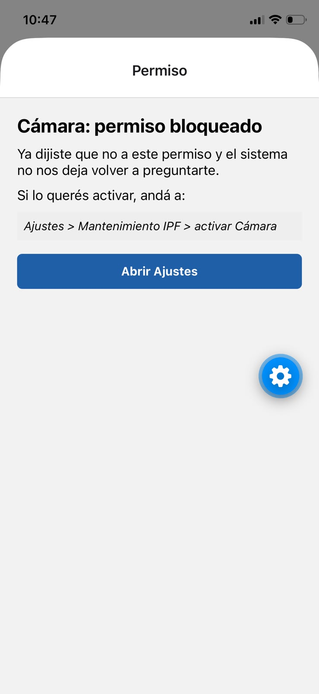 |
| Micrófono bloqueado: se puede escribir la descripción | Micrófono bloqueado | Cámara bloqueada |
| 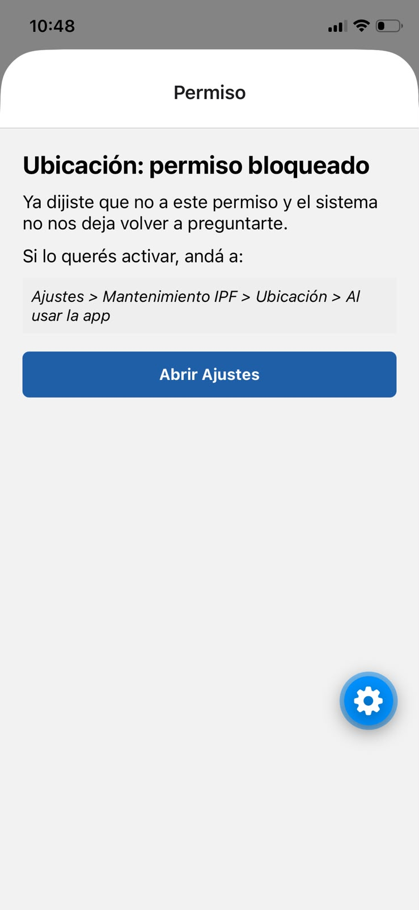 | 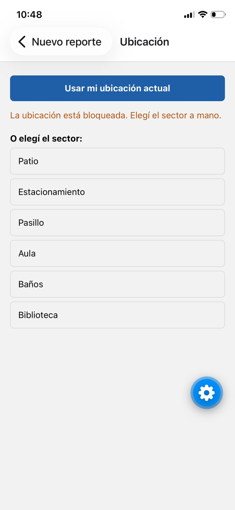 | 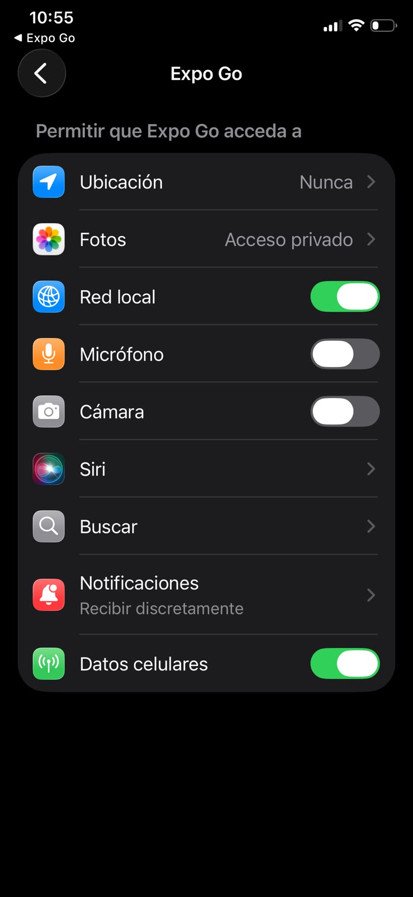 |
| Ubicación bloqueada | Sin ubicación se elige el sector a mano | Ajustes de iOS con todo apagado |

### Permisos concedidos

| | | |
|---|---|---|
| 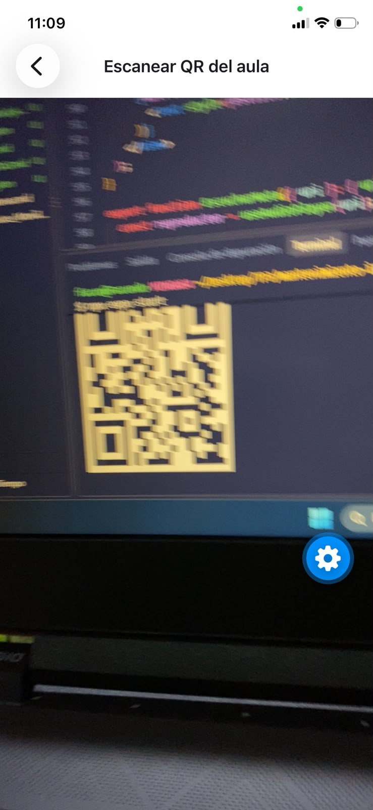 | 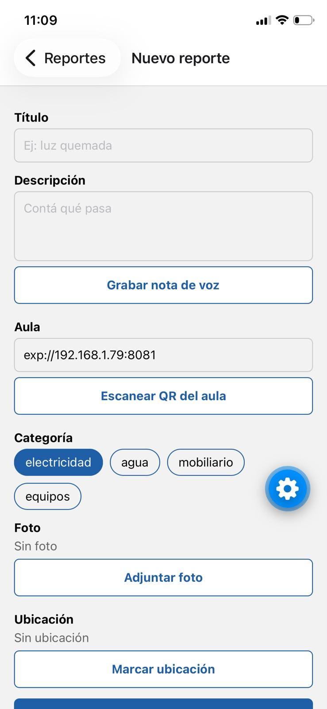 | 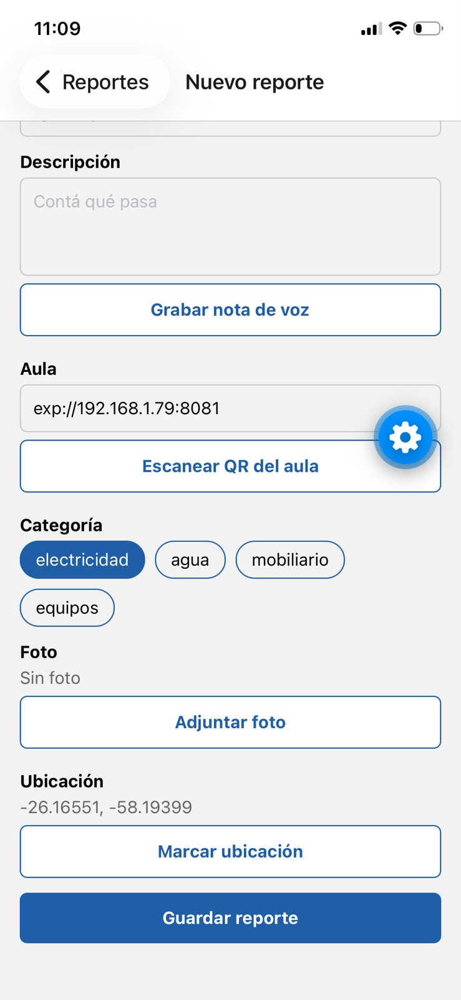 |
| Escáner leyendo un QR | El aula se completa con el QR | Ubicación guardada |
| 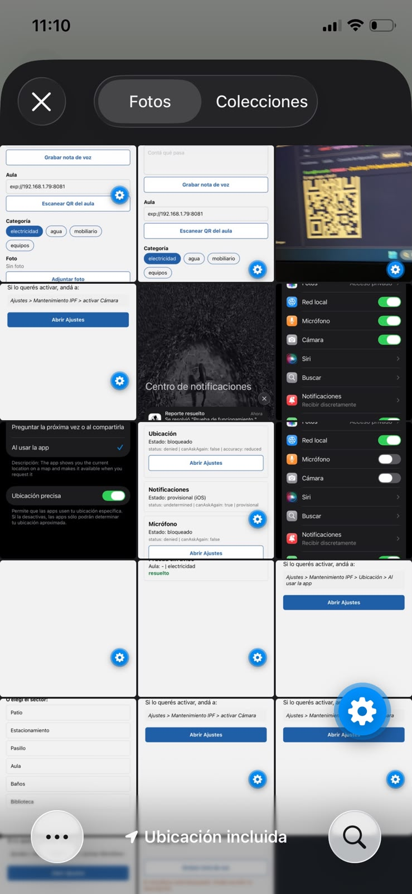 | | |
| Selector de fotos (no pide permiso) | | |

### Panel de permisos antes y después de Ajustes

| | | | |
|---|---|---|---|
| 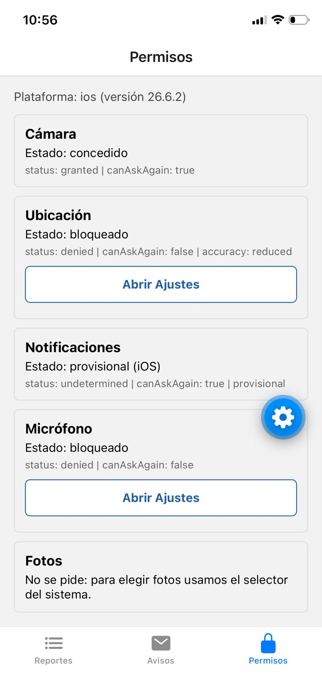 | 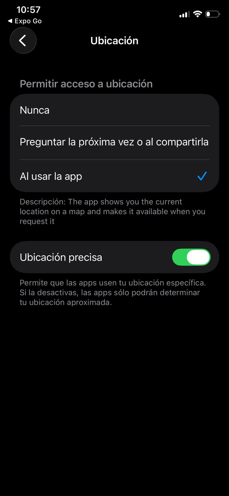 | 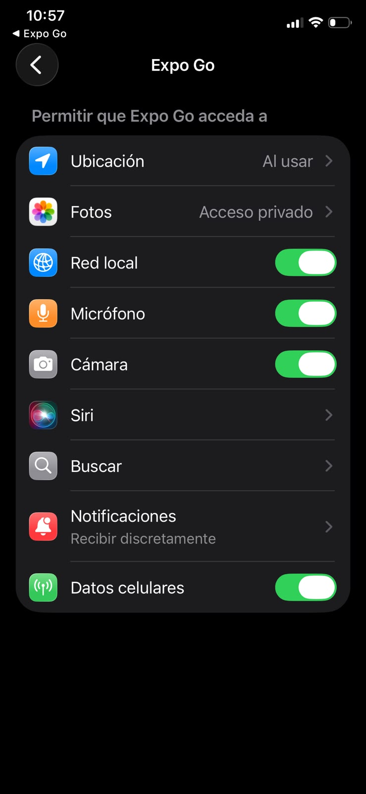 | 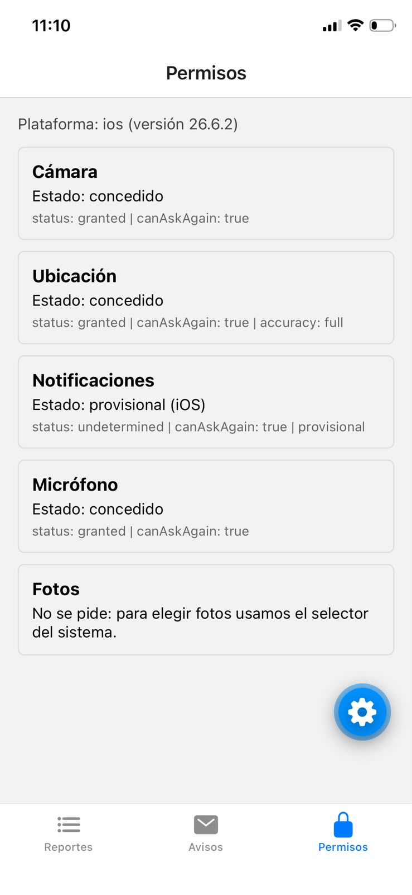 |
| Antes: ubicación y micrófono bloqueados | Activo la ubicación | Activo cámara y micrófono | Al volver, el panel se actualiza solo |

### Avisos y notificaciones

| | | |
|---|---|---|
| 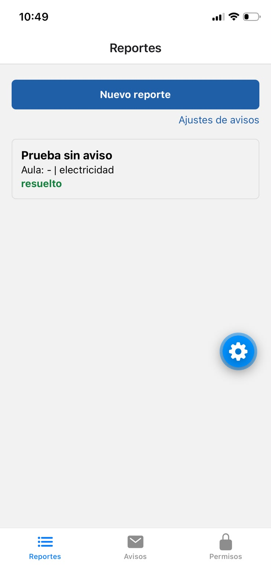 | 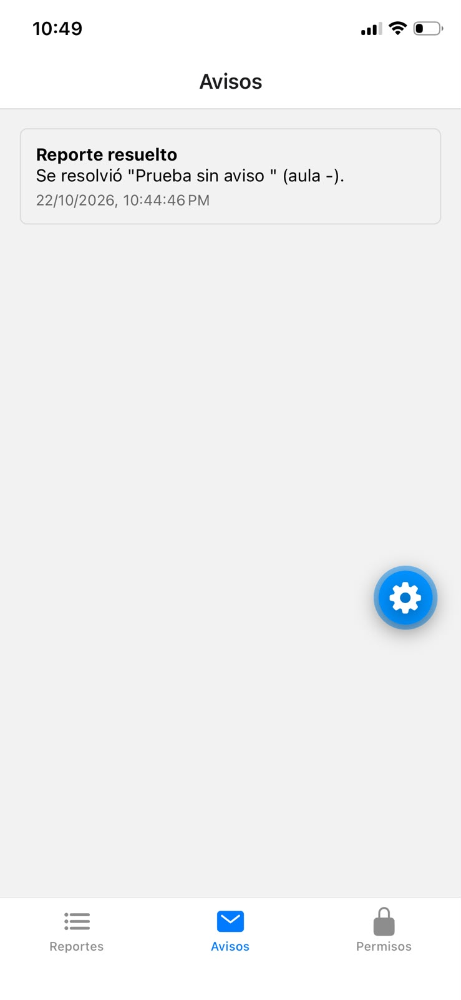 | 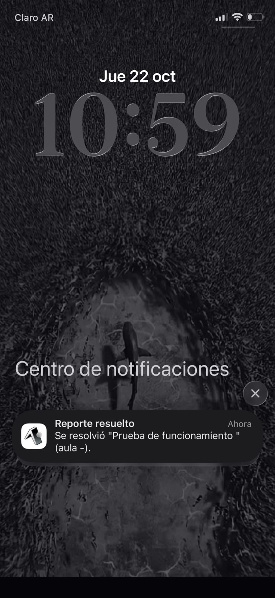 |
| Reporte resuelto | Con las notificaciones apagadas el aviso queda en Avisos | Con las notificaciones activadas llega a los 10 segundos |

Me faltaron la pantalla previa con "Continuar" (en iPhone hay que reinstalar Expo Go para que vuelva a preguntar), la de "cargando" (dura muy poco) y el diálogo con mi texto de propósito (solo se ve en una development build).
